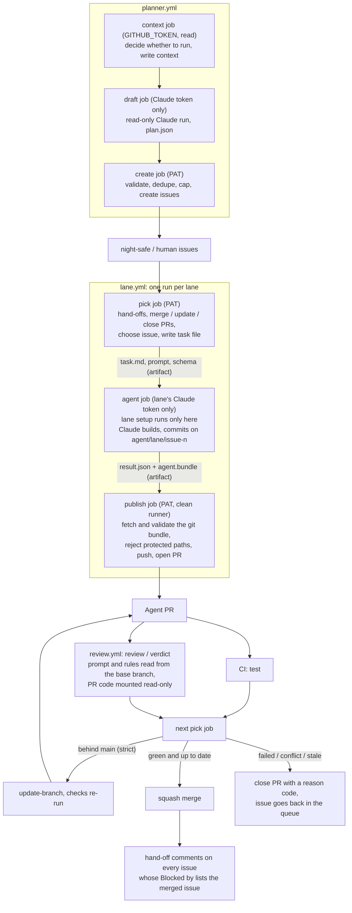

# gh-nightshift

Claude agents build your GitHub issues overnight, in parallel lanes, and merge what passes your tests and an
independent review.

`gh nightshift` is a `gh` CLI extension (Python 3.10+, standard library only, plus the `gh` binary) and three
reusable GitHub Actions workflows:

- `lane.yml` runs one lane: pick an issue, let a Claude agent build it, open a PR.
- `review.yml` is the review gate. A second Claude run, with read-only tools, reviews each agent PR and sets the
  required check `review / verdict`.
- `planner.yml` turns docs, a gap analysis or a request into tickets the lanes can pick up.

A lane is a slice of the repo (for example `api/` or `web/`) with its own Claude token. Each lane works on one
issue at a time. Lanes coordinate only through GitHub issues and machine-readable comments. Nothing runs on
your machine overnight.

It was extracted from the kit used in a hackathon. `docs/EXTRACTION.md` lists every hackathon-specific
assumption and what became of it.

**Alpha testers:** start with [docs/ALPHA.md](docs/ALPHA.md). It covers install, setup, joining a lane,
troubleshooting and what to report.

## 10-minute setup

You need admin rights on the repo, `gh` logged in with the `workflow` scope (`gh auth refresh -s workflow`),
Python 3.10 or newer, and a CI workflow whose test job is called `test`. If it has another name, change
`required_checks` in the config.

1. Install the extension.

   ```sh
   gh extension install paawandesai/gh-nightshift
   gh alias set night-shift nightshift   # optional: lets you type `gh night-shift`
   ```

2. Run `init` in your checkout.

   ```sh
   gh nightshift init          # interactive; --yes accepts every suggestion, --dry-run prints the GitHub calls
   ```

   `init` detects your stack, then asks for the lanes, the folders each lane owns, setup and test commands,
   your CI file and the merge mode. It writes:

   - `.night-shift/config.yml`
   - `.github/workflows/night-shift.yml` (one job per lane), `night-shift-review.yml`, `night-shift-planner.yml`
   - `.github/ISSUE_TEMPLATE/night-shift-ticket.md`, `docs/NIGHT_SHIFT_ISSUES.md` (the ticket guide),
     `AGENT_RULES.md` (paste it into your `CLAUDE.md`)

   Then it sets up the repo: labels, squash merge and delete-branch-on-merge, the `AGENTS_ENABLED`
   (`false`) and `FIX_LANE` variables, and a `night-log` issue. Last, it asks for any missing secrets, without
   echoing them. Branch protection waits until step 4, so it does not refuse the push of these files.
   The workflows are pinned to the commit of the extension's release you installed (`tool_ref: <40-character SHA>
   # v0.2.0`), because a tag can be moved and this code runs with your PAT; `--tool-ref` picks another tag or SHA,
   which `init` also resolves to its commit.

3. Create the secrets (`init` asks for them; `gh nightshift join --lane <name>` lets a teammate add their own).

   | Secret | What it is |
   |---|---|
   | `AGENT_PAT` | A fine-grained PAT for this repo only, owned by the account the night shift acts as. Permissions: Contents, Issues and Pull requests read/write; Actions and Commit statuses read. **No Workflows permission.** |
   | `CLAUDE_TOKEN_<OWNER>` | One per lane owner, from `claude setup-token`. The secret name is `lanes[].claude_token_secret`. |
   | `CLAUDE_TOKEN_REVIEW` | For the review gate, ideally from someone who does not own a lane (`review_token_secret`). |

   A lane can name its own PAT with `agent_pat_secret`, so its PRs are credited to the lane owner. While that
   secret is unset, the lane falls back to `AGENT_PAT`. To pair every lane with its owner's PAT and Claude token
   at once, run `init --owners api=alice,web=bob --lane-pats --bot-login <AGENT_PAT's login>`: each lane gets
   `CLAUDE_TOKEN_<OWNER>` and `AGENT_PAT_<OWNER>`, the owners become `trusted_logins`, and each owner stores their
   two secrets with `gh nightshift join --lane <lane>`. The planner, digest and commands still use `AGENT_PAT`.

   A lane can also name `fallback_token_secret`, a second Claude token (for example from its owner's second
   account). The agent switches to it only when the lane's own token cannot start a run (usage limit, expired or
   revoked token); the run log says `claude token: fallback`. Store it with `gh nightshift join --lane <lane>
   --fallback`, and run `gh nightshift init --regenerate` after adding the key so the caller passes it.

4. Commit and push the new files to main, then protect main and check the setup.

   ```sh
   gh nightshift setup                     # branch protection: required checks test + review / verdict, strict
   gh nightshift doctor                    # prints a fix for every problem
   gh nightshift doctor --pat-env MY_PAT   # also checks the PAT held in $MY_PAT
   ```

5. Label a few issues `night-safe` plus exactly one `lane:<name>`. Follow `docs/NIGHT_SHIFT_ISSUES.md`, and
   run `gh nightshift lint` to check them against that guide. Then switch it on.

   ```sh
   gh nightshift start
   gh nightshift status   # what each lane would do right now
   ```

Lanes run on every push to main, whenever CI or the review finishes, every 20 minutes, and on manual dispatch.
`gh nightshift pause` stops them.

## How it works



The rules behind the diagram:

- **The agent never shares a runner with the GitHub token.** The pick and publish jobs hold the PAT. The agent
  job gets only that lane's Claude token. Lane setup (commands, a composite action, a Postgres service) runs
  only in the agent job.
- **The publish job trusts nothing the agent produced.** It fetches the bundle into a fresh checkout. It
  rejects the bundle if the diff touches a protected path, and only then pushes and opens the PR. Needs,
  notes and follow-ups are capped.
- **A PR merges only when GitHub's branch protection allows it.** Both required checks (`test` and
  `review / verdict`) must pass, and in strict mode the branch must be up to date with main.
- **One PR per lane at a time.** While a lane's PR is open, that lane only manages the PR.
- **Main must be green.** If the latest CI run on main failed, only the fix lane works, and it works on fixing
  main (`max_attempts` tries per failing commit).
- **Order of work.** Lowest `wave:N` label first, then lowest issue number. An issue is skipped if it is
  assigned to someone, if any `Blocked by` issue is still open, or if it carries `blocked`, `needs-human`,
  `human`, `proposed` or `integrator`.
- **Retries and caps.** A failed attempt retries with the escalate model. After `max_attempts` failed attempts
  (or `infra_cap` runs that never started), the issue gets the `blocked` label. Runs that never started
  (expired token, usage limit, outage), merge conflicts and review-gate errors are refunded, not counted.

## Config reference

Everything lives in `.night-shift/config.yml`. The annotated example is
[`examples/config.yml`](examples/config.yml). The schema, with every key and its limits, is
[`nightshift/schema/config.schema.json`](nightshift/schema/config.schema.json). After changing lanes, run
`gh nightshift init --regenerate` to rewrite the caller workflows.

| Key | Default | What it does |
|---|---|---|
| `lanes[]` | required | `name`, `paths`, `claude_token_secret`, optional `agent_pat_secret`, `fallback_token_secret` (a second Claude token used only when the first cannot start a run), `model`, `escalate_model`, `description`, `test_command`, `setup.commands`, `setup.action`, `postgres_image`, `sudo` (`false`: the agent runs without sudo or, on lanes without `postgres_image`, Docker; setup still has them. GitHub-hosted runners only) |
| `main_branch` | `main` | Branch the lanes build on and protect |
| `ci_workflow` | `ci.yml` | CI file whose runs on main gate every lane |
| `required_checks` | `[test, "review / verdict"]` | Required status checks; a PR counts as green only when all have reported |
| `fix_lane` | first lane | The only lane that works while main is red |
| `merge.mode` | `strict` | `strict` or `queue` (see below) |
| `merge.allow_unenforced` | `false` | The picker merges a green PR only when main's branch protection or a ruleset enforces every required check. `true` merges anyway (a free private repo cannot have branch protection) |
| `protected_paths` | `[]` | Added to the built-in list (`.github/`, `.claude/`, `CLAUDE.md`, `CLAUDE.local.md`, `AGENTS.md`, `AGENT_RULES.md`, `.mcp.json`, `.night-shift/`, plus `planner.docs` when `planner.refill_below` is on); never replaces it. `dir/` covers a folder, a glob such as `**/package.json` matches at any depth |
| `models` | `sonnet` / `opus` / `opus` / `opus` | `default`, `escalate`, `review`, `planner` |
| `limits` | 3, 6, 45, 80, 2, 2, `true` | `max_attempts`, `infra_cap`, `stale_minutes`, `max_turns`, `max_needs_per_issue`, `max_notes_per_issue`, `auto_ready_needs` (`false`: an agent's request to another lane waits as `proposed` until a person promotes it) |
| `planner` | | `docs`, `max_tickets_per_run` (8), `refill_below` (0 = off), `id_prefixes`, `human_paths` (`[contracts/]`), `claude_token_secret`, `schedule`, `enabled` |
| `labels` | | Rename any of the standard labels (`ready` is `night-safe` by default) |
| `review_token_secret` | `CLAUDE_TOKEN_REVIEW` | Claude token secret for the review gate |
| `timezone` | `UTC` | Time zone for night-log lines |
| `tool_ref` | `main` (`init` writes the installed release's commit) | Ref of gh-nightshift the workflows use. Pin a 40-character commit SHA; `doctor` warns about a tag (which can be moved) or a branch. |
| `bot_login` | you | The PAT's login, for read-only commands run as someone else (`stats`, `audit`, `digest`) |
| `trusted_logins` | `[]` | Other PAT logins to trust, when lanes use their owners' own PATs (`join --lane X` stores one) |
| `cross_repos` | `[]` | Repos (`owner/name`) whose issues a ticket may depend on with `Blocked by: owner/repo#N` (see Cross-repo dependencies) |
| `environment` | none | A GitHub environment for the jobs that hold the PAT or App key (see Credentials in an environment) |
| `lanes[].budget_usd_per_night` | off | Optional cap: the lane stops picking for the night (noon to noon in `timezone`) once its night-log cost lines reach it |
| `auth` | `mode: pat` | `mode: app`, `app_id`, `private_key_secret` (`NIGHT_SHIFT_APP_KEY`): a GitHub App instead of `AGENT_PAT` |
| `review` | `reuse_on_update: true` | Keep a passed verdict when update-branch only merged main (see Merge modes) |
| `redteam` | `enabled: false` | `enabled`, `schedule` (`0 5 * * *`), `min_severity` (`high`), `claude_token_secret` (default the security token; a dedicated token is recommended, see SECURITY.md), `model`, `validate` (`enabled: false`, `max_per_run: 3`) and `level` (`1`; `0` reports only), see Validation and the shared security context. See Review rules and the security gate |
| `reduce` | `enabled: false` | `enabled`, `schedule` (`30 6 * * *`, no minute in common with `planner.schedule`), `window_hours` (48). Needs `planner.enabled`. See Reduce |
| `security` | `enabled: false` | `enabled` (adds the required check `review / security`), `claude_token_secret` (default `review_token_secret`), `model`, `paths` (always reviewed, as are `risk.approve_paths`), `always` (review every PR). See Review rules |
| `risk` | `default: auto` | `default` (`auto` or `approve`), `approve_labels`, `approve_paths` (`init` writes a default list of dependency manifests, lockfiles, package-manager, editor, hook and container config), `auto_labels`, `codeowners` (see Risk tiers) |
| `extends` | | `owner/repo` with an org-wide `.night-shift/config.yml` (see Org-wide config) |
| `runners` | `ubuntu-latest` | `github` (jobs holding the PAT or App key: pick, publish, planner context and create, commands, digest) and `agent` (jobs that run Claude: the lane agent, planner draft and reviewer): a runner label or a list. Each needs a label the other lacks, and self-hosted runners for the two must be separate machines (see SECURITY.md); `init --regenerate` writes them into the callers |
| `digest` | | `weekly_schedule` (`0 8 * * 1`, `""` = off), `enabled` (true), `schedule` (`0 7 * * *`, UTC), `webhook_secret` (optional secret holding a Slack or Discord webhook URL) |

Repo variables override some settings at run time without a commit: `AGENTS_ENABLED`, `FIX_LANE`,
`ESCALATE_MODEL`, `REVIEW_MODEL` (fallback), `PLANNER_MODEL`, `CLAUDE_CODE_VERSION`,
`CLAUDE_PERMISSION_FLAGS` and `NIGHT_SHIFT_TOKEN_IN_ENV` (see SECURITY.md, known gap 2). `CLAUDE_CODE_VERSION`
defaults to a version this release was tested with (2.1.319), never `latest`. A project can replace a prompt by committing `.night-shift/prompts/worker.md`,
`review.md` or `planner.md` on the default branch.

## The comment protocol

Every fact that lanes share is a hidden marker inside an ordinary comment:

```html
<!-- ns:{"from":12,"lane":"api","pr":40,"to":15,"type":"handoff"} -->
```

**Trust rule.** A marker counts only if the comment was posted by the PAT's own login, the account the lanes
act as. Anyone else can paste the same text, and it is ignored, even when the author is a repo admin. So an
outsider cannot forge attempt counts, unblock an issue or steer work.

| Type | Where | Meaning |
|---|---|---|
| `attempt`, `infra`, `blocked`, `waiting` | issue | Attempt bookkeeping. `infra` (never started) and `waiting` do not count as failed attempts. |
| `fix-attempt`, `fix-infra` | night-log issue | The same bookkeeping for fix-main, per failing commit |
| `need` | waiting issue | `{"from": waiting issue, "to": provider issue, "lane": provider's lane}` |
| `handoff` | dependent issue | `{"from": merged issue, "to": dependent issue, "pr": merged PR}` |
| `note` | receiving issue | `{"from": sender issue, "to": receiver issue}` |
| `note-sent` | sending issue | One per note sent, so the cap can be counted |
| `pr` | PR | `{"reason": ..., "pr": n, "issue": n}` |
| `handoff-data` | PR body | The agent's hand-off, read when the PR merges |
| `handoff-done` | merged PR | Hand-offs went out (makes the step idempotent) |
| `plan` | night-log issue | A planner run: lane, `complete`, `docs_sha`; a reduce run has `lane: reduce` and `prs` |
| `redteam` | night-log issue | A red-team scan: `sha` (the commit it reached) and `base` |
| `redteam-finding` | draft security advisory or `security` issue | The finding's fingerprint `fp` (title + file), `wk` (CWE + file), `sha` and, with validation on, `validated` (the verdict), so it is filed once |
| `redteam-skip` | night-log issue | `fps`: fingerprints of findings whose repro test did not fail, so later scans skip them (a full scan tries them again) |

**Hand-off.** When a PR merges, the picker posts a hand-off comment on every open issue whose `Blocked by`
line lists the merged issue (for PRs merged in the last 72 hours). The comment gives the interface as built
(functions, endpoints), files, env vars, decisions and assumptions from the agent's `handoff` output. It also
quotes the ticket's `## Interface` section and flags any difference the agent reported. The next agent sees
these comments in its task file, in a section marked trusted.

**Needs a decision.** When a review fails because the ticket itself keeps the code from passing (it fixes a
signature that a repo rule or the security review forbids), the next attempt reports `decision` instead of
trying the same contract again: the issue gets `needs-human` and is not retried, the attempt is not counted,
and the agent files a `proposed` follow-up saying how the ticket should change (even if an earlier attempt
already filed follow-ups). The planner also sees the repo review rules, so it
should not write such tickets in the first place.

**Waiting on another lane (needs).** An agent that hits something another lane owns and that does not exist
yet reports `waiting`, with up to 2 `needs`. For each need, the publish job does three things:

1. It files a ticket in that lane, or reuses an existing one with the same title. A ticket that passes the
   ticket validator is `night-safe` at once; otherwise it is `proposed`. It is `human` if it touches protected
   or contract paths. With `limits.auto_ready_needs: false`, every such ticket is `proposed` and a person swaps
   the label for `night-safe` before the other lane builds it, so one agent cannot queue work for another unseen.
2. It appends `Blocked by: #new` to the waiting issue and labels the issue `waiting`.
3. It records the attempt as not counted.

Needs are capped at `max_needs_per_issue` (2) per issue across all runs. A need that would create a
dependency cycle is refused, and the issue gets `needs-human`. If no need could be filed, the run counts
as a failed attempt.

**Notes.** An agent can send up to `max_notes_per_issue` (2) informational notes per issue to other open
issues, for example "I added helper X you can reuse". Notes are quoted and never change state.

**PR reason codes.** Every agent PR that closes without merging gets a `pr` marker with one of
`verdict_failed`, `security_failed`, `checks_failed`, `conflict`, `stale` (no checks after `stale_minutes`) or `superseded`
(its issue closed, or a newer attempt replaced it). A closed PR with no marker counts as `manual`.
Merged PRs get `verdict_passed`. `gh nightshift stats` reports these codes.

## The planner

The planner drafts tickets in a read-only Claude run. A separate job holding the PAT validates and creates
them.

| Mode | How it starts | What it plans |
|---|---|---|
| `prd` | `gh nightshift plan --from docs/PRD.md`, or the planner workflow's dispatch | Every requirement in the docs |
| `gap` | `gh nightshift plan --gap [--lane X]`, or dispatch | What the docs ask for and the code lacks |
| `review` | A comment starting with `/night-shift plan <request>` on an issue, from a user with write access | Only what the request needs; the request is fenced as data |
| refill | Timer (`planner.schedule`) when `planner.refill_below > 0` | Gap mode for the lane with the fewest ready issues, when it has fewer than `refill_below` |
| `reduce` | Timer (`reduce.schedule`) when `reduce.enabled`, or dispatch | Problems across lanes in the agent PRs merged in `reduce.window_hours` (see Reduce); tickets are `proposed` |

The validator applies the ticket guide (`docs/NIGHT_SHIFT_ISSUES.md`). A ticket must have:

- a title `[ID] outcome` (the ID is assigned if missing; a malformed or reused ID is rejected),
- `Goal`, `Do`, `Acceptance` and `Files` sections,
- exactly one configured lane and a wave from 0 to 99,
- a `## Interface` section if it has a `Blocked by` line or another ticket depends on it,
- `Blocked by` targets that exist (another draft or an existing issue), with no cycles,
- a title that does not duplicate an open issue.

Tickets that touch protected paths or `planner.human_paths` (default `contracts/`) are created as `human`
tickets, which agents skip. Invalid tickets are not created, nor are tickets that depend on a rejected
ticket. A run creates at most `planner.max_tickets_per_run` tickets (8), in dependency order.

**Coverage stopping rule.** The plan lists every requirement as `done`, `ticketed` or `deferred` (with a
reason). When nothing is left uncovered, the run is complete and is logged on the night-log issue with the
docs' commit SHA. Refill does not run again until the docs change.

Follow-up work an agent notices while building is filed as `proposed` (at most 3 per run, deduplicated).
Agents skip it until a person relabels it `night-safe`.

### Reduce

Each agent PR is reviewed on its own, so two lanes can both pass while disagreeing about the interface between
them. With `reduce.enabled`, the planner workflow runs once a day (`reduce.schedule`, default `30 6 * * *` UTC)
in `reduce` mode. The context job (GITHUB_TOKEN) collects the agent PRs merged in the last
`reduce.window_hours` (48) from the PAT's login or `trusted_logins` that no earlier reduce covered, each one's
ticket `## Interface`, the agent's hand-off (from the trusted marker in the PR body only), and the open lane
tickets that are `Blocked by` them, all fenced as data. PRs an earlier run covered are listed for reference, so a
late or failed run is caught up by the next one. The read-only draft job compares those claims with the code on main and drafts tickets for
contract mismatches, drift from the ticket that a consumer relies on, contradicted assumptions, cross-lane
chains and duplicated work, with one coverage entry per merged PR. The create job validates them like any plan
and files every ticket as `proposed` (or `human` for protected paths): a person reads it and swaps the label
for `night-safe` to queue it. The run is skipped when nothing merged, when only one lane merged and no open
lane ticket depends on it, or when `plan` markers with `lane: reduce` already list every PR in the window. The
planner caller needs `pull-requests: read`; `init --regenerate` adds it.

## Commands

Every command that writes to GitHub accepts `--dry-run`, which prints the exact `gh api` and `gh secret set`
calls instead of making them. All commands accept `--repo OWNER/NAME` and `--root PATH`.

| Command | What it does |
|---|---|
| `init` | `--template hackathon` starts from a weekend-build setup (planner refill below 3, 2 attempts, 30-minute stale limit, digest every 4 hours, a `docs/PRD.md` and `contracts/` stub). Write config and workflows, set up labels, settings, variables, night log, roadmap, secrets (branch protection: run `setup` after pushing). `--yes`, `--lanes`, `--tool-ref`, `--force`, `--regenerate` (rewrite workflows only), `--files-only`, `--skip-secrets`, `--dry-run`. Fully non-interactive with `--yes --lanes api,web --preset python --paths api=api/ --budget 5 --secrets-from-env`. `--owners api=alice,web=bob --lane-pats --bot-login night-bot` gives each lane its owner's own PAT and Claude token |
| `setup` | Re-apply labels, settings, variables, branch protection, the night log and the roadmap |
| `join --lane X` | A teammate stores their Claude token and their own PAT for a lane (`--no-pat` to skip); prints the `trusted_logins` line to add. `--fallback` stores the lane's fallback Claude token instead |
| `doctor` | Read-only checks with a fix for each problem (`--pat-env VAR` checks a PAT; repeat it for each) |
| `status` | What each lane would do now, the queue, open agent PRs, blocked and waiting issues, the night log |
| `stats` | Merge rate with a 95% interval, reason codes, escalation share, cost per merged PR (`--audit CSV` adds the review gate's catch rate; `--org ORG` summarises every repo in an org that has a night-shift config). Counts PRs and markers from `bot_login` in the config (default: you), so set it when the PAT is another account. |
| `plan` | Draft and create tickets: `--from PATH`, `--gap`, `--lane X`, `--plan-file` (publish an existing draft) |
| `start` / `pause` | Set `AGENTS_ENABLED` to `true` / `false` (the kill switch); `pause` also cancels lane runs in flight (`--no-cancel` to let them finish) |
| `freeze` / `resume` | Pause (and cancel) and move every ready issue to `human` + `frozen`; `resume` undoes it and starts |
| `take N` / `retry N` | Take a ticket yourself, or put it back in the queue with fresh attempts (same as the comment commands) |
| `app manifest` / `app check` / `app installations` | Print the GitHub App to create; mint a token locally and show its login and permissions; list every account and repo the App is installed on (suspended or not) with the App's newest comment in each, using read-only tokens |
| `roadmap` | Create or refresh the roadmap issue: tickets by wave with status, a Blocked-by mermaid graph, counts per lane. The planner and every merge refresh it too. `plan --show` prints it without writing. |
| `digest` | `--weekly` reports the last 7 days (the generated workflow also runs it on `digest.weekly_schedule`). Summarise the last `--hours 24`: merged, closed with reasons, stuck, cost per lane. `--post` puts it on the night log; `--webhook-env VAR` also sends it to the Slack or Discord webhook URL in `$VAR`. The generated `night-shift-digest.yml` runs it every morning. |
| `lint` | Check ready issues against the ticket guide |
| `rules` | Run `.night-shift/review-rules.yml` over this branch's diff and print the hits the reviewer would get (`--base origin/main`) |
| `audit-log` | Export every agent PR: lane, issue, outcome, reason code, model, prompt version, cost (`--since`, `--format csv\|jsonl`, `--out`) |
| `config pull` | Copy the org-wide base config from the `extends:` repo into `.night-shift/base.yml` |
| `audit` | Sample merged agent PRs (`--sample 25 --seed 1`), collect evidence, optionally rerun tests (`--test-cmd`), and report rates (`--report CSV`; `--label-llm CSV` pre-fills LLM labels, which are not ground truth) |

## Review rules and the security gate

The review gate's six questions apply to every PR alike. `.night-shift/review-rules.yml` adds checks tuned to
your repo: each rule selects code a PR adds or changes and asks one yes/no question about it, phrased so that
"yes" means the concern is handled. The rules run deterministically (stdlib regex and Python `ast`, no PR code
executed), so the same diff always gets the same checklist, and the reviewer must answer every hit. A hit left
unanswered or answered `no` fails the review. The file is read from the base branch and is a protected path,
so agents cannot change the rules that judge them. An annotated example is
[`examples/review-rules.yml`](examples/review-rules.yml).

| Kind | Selects |
|---|---|
| `regex` | Added lines matching `pattern` (`unless`: skip files that match another regex) |
| `python-call` | Added or changed calls whose dotted name matches `pattern` (`subprocess.run`, `cur.execute`) |
| `python-decorator` | Added or changed functions with a decorator matching `pattern`; with `requires`, only those lacking a decorator matching `requires` (a route without its auth wrapper) |
| `path` | Every changed, added or deleted file under `paths` / matching `glob` |

Every rule may narrow itself with `paths` and `glob`, and has a `severity` (`low` to `critical`). Rules are
selectors that guarantee the reviewer looks at matching code; they are not a security boundary on their own
(an aliased import can avoid a `python-call` pattern), and a file a rule cannot read becomes a check-by-hand hit. Run
`gh nightshift rules` on a branch to see the checklist a PR would get, and `doctor` to validate the file.

**The security gate.** With `security: {enabled: true}`, a second read-only reviewer runs as the required check
`review / security`. It looks only for changes that make the application exploitable (missing or misplaced
authorisation, injection, traversal, SSRF, open redirects, secrets, and how the change combines with existing
code), and must answer every `security: true` rule hit. It calls Claude only when a security rule hits, the PR
touches `security.paths` or `risk.approve_paths`, or `security.always` is on; otherwise it passes at once. A
high or critical finding fails it, and the picker closes the PR as `security_failed`. After enabling it, run
`gh nightshift init --regenerate` and `gh nightshift setup`.

**The red-team scan.** With `redteam: {enabled: true}`, `night-shift-redteam.yml` runs once a day
(`redteam.schedule`, default `0 5 * * *` UTC) and reads main the way an attacker would. It is incremental: a
`redteam` marker on the night log records the commit each scan reached, so the next one reads only what changed
since then (a quiet night skips without calling Claude), and dispatching it with `full` rescans the whole tree.
The `security: true` rules run over that range and become its must-check list. Three jobs keep the usual split:
`context` (GITHUB_TOKEN) picks the range and runs the rules, `scan` (the Claude token only, read-only tools)
returns findings encrypted with its Claude token, and `file` (the PAT, or an App token minted with one extra
permission) decrypts them inside a pipe and files each new finding at `redteam.min_severity` (`high`) or above:

- on a **public** repo, as a **draft private security advisory**, which only repo admins and the advisory's
  collaborators can read. The night log only says the scan ran: not even a count, which would tell an attacker
  that main has an open hole. This needs `Repository security advisories: Read and write` on the PAT (whose
  account must be a repo admin or security manager) or approved on the App;
- on a **private** repo (GitHub has no advisories there), as an issue labelled `security` and `human`, which only
  repo members can see and agents never pick up. The night log gets counts and issue links.

Findings never appear in a log or an artifact, a fingerprint (title and file, or CWE and file, since the model
rewords titles) keeps a finding from being filed twice, and a scan that fails or is cut short records nothing, so the next one covers the same range again. The
scan needs `bot_login` in the config. Dispatches from another branch are skipped. Give the scan its own
Claude token (`redteam.claude_token_secret`): the encrypted findings in public logs are only as safe as that token.

**Validation and the shared security context.** A scan that only reads code reports some things that cannot
be reached in practice. With `redteam: {validate: {enabled: true}}` on a **private** repo, a `validate` job runs
between `scan` and `file`. Each new finding (at most `validate.max_per_run`, default and maximum 3, each on its
own fresh runner) gets main checked out and the owning lane's `setup.commands` run, and Claude writes one test
that performs the attack and asserts the safe behaviour, so it fails while the bug exists. Then the harness, not
the model, runs that test twice and decides:

| Verdict | When | What `file` does at `level: 1` |
|---|---|---|
| `validated` | both runs fail as a test failure (exit code 1, no import, syntax or collection error) | files the issue with the repro test, the command and the end of the output |
| `not_reproduced` | the test passes, errors, times out or is flaky | does not file it; lists its fingerprint on the night log and skips it in later scans. A `critical` one is still filed, labelled `unconfirmed` |
| `not_testable` | the model says the runner lacks what the test needs | files it labelled `unconfirmed` |

A finding with no result yet (more than `max_per_run` in one night, or a validation job that failed) is not
filed, and the scan does not record its position, so the next run covers the range again. `level: 0` is a shadow
mode: everything runs, the night log reports each verdict, nothing is filed and the scan's position does not
move. Start there, read a few nights of results, then set `level: 1`. On a public repo validation stays off and
findings are filed as before.

Every security pass (the scan, the validation runs and `review / security`) first reads
`.night-shift/SECURITY.md` from the default branch: a system map, the invariants the code must keep, the checks
that guard fixed findings, and a "Not a finding" list. `init` writes a starter. An entry under "Not a finding"
that names a fingerprint (`fp:` and the 16 characters the night log prints) stops that finding from being
validated or filed again. The file is under `.night-shift/`, so agents cannot change it: only a PR a person
merges does. Never put an open finding or an attack path in it. `doctor` warns when validation is on and a lane
has no `test_command`, the file is missing, or the scan shares its Claude token with a lane or the reviewer.

## Merge modes

- **`strict`** (default): branch protection requires PRs to be up to date with main. When a lane's PR is
  behind main, the picker calls `update-branch`, and CI and the review run again on the merged result. A
  conflict while updating closes the PR as `conflict`, and the attempt is refunded. Main is never ahead of
  what was tested. Each update re-runs CI. The review and security gates keep their passed verdict instead of
  calling Claude again when the update only merged main, the PR's own diff is unchanged, and main changed none
  of the PR's files and none of the review inputs (workflows, `CLAUDE.md`, `.night-shift/`). The PR gets a
  comment saying so. `review: {reuse_on_update: false}` turns this off; it needs `checks: read` in the review
  caller, which `init --regenerate` adds.
- **`queue`**: `setup` creates a GitHub merge queue ruleset, and your CI must also run on `merge_group`
  (`doctor` checks this). The queue tests the merged result, so the branch need not be up to date.
  Limitation in v0.1: the picker does not add PRs to the queue or enable auto-merge, so a person (or other
  automation) must queue green agent PRs. Use `strict` for unattended nights.

## Risk tiers

Green agent PRs merge on their own by default. In `strict` mode you can ask for one human approval first:

```yaml
risk:
  default: auto            # or approve: every PR needs one, except tickets with an auto_labels label
  approve_labels: [risk:high]   # on the issue or the PR
  approve_paths: [migrations/, infra/]
  auto_labels: [risk:low]
```

`risk.codeowners: true` adds CODEOWNERS (read from the default branch, never the PR): every changed file
that has owners needs an approval from one of them; a team or email owner accepts any writer, because a
repo-scoped token cannot read team membership. `init` turns this on when it finds a CODEOWNERS file, and
`doctor` warns when CODEOWNERS exists but it is off. Renames count under both names, and a PR too large to
list completely always needs approval. Risk tiers apply in `strict` mode only; in `queue` mode a person
queues every PR anyway. The approver cannot be the PR's author, which is the PAT's account: if that is your
own account, a second writer has to approve.

A PR that needs approval gets the `needs-approval` label and one comment (again if its head commit changes). It merges on the next lane run after
someone with write access who did not open it approves its latest commit. Waiting for approval does not hold
up the lane: it moves on to the next ticket and never re-picks that one.

## Comment commands

People with write access can comment on a ticket (or on its agent PR):

| Command | What happens |
|---|---|
| `/night-shift take` | You take the ticket: assigned to you, labelled `human`, agents skip it. An agent PR already open for it still merges when green; close it if you don't want that. |
| `/night-shift retry` | Back in the queue with fresh attempts: `blocked`, `needs-human`, `human` and `frozen` are removed, `night-safe` added, a closed issue is reopened and a `take` is undone. Hints in your comment reach the next agent through the discussion section. |

Both accept `#n` to name another ticket. `gh nightshift take N` and `gh nightshift retry N` do the same from
the terminal. They run in the generated `night-shift-commands.yml` with the PAT (or the App).

## Cross-repo dependencies

`Blocked by: org/other-repo#12` (or the issue's URL) makes a ticket wait for an issue in another repository.
The repository must be listed in `cross_repos` (default: none), so a ticket cannot make the PAT read and copy
text from any repo its owner can see; an unlisted one is never read and the ticket waits. The PAT (or App)
must be able to read that issue; if it cannot, the dependency counts as unmet. When it
closes, the waiting side posts the hand-off itself (this repo's token cannot write to the other one): the
other issue's title and `## Interface` section, quoted as data from another repository.

## Org-wide config

Put shared settings in `your-org/.github/.night-shift/config.yml`, add `extends: your-org/.github` to each
repo's config, and run `gh nightshift config pull`. It writes `.night-shift/base.yml`; commit it. The repo's
own config wins key by key, `protected_paths` are added together, and only shared settings are taken from the
base: `models`, `limits`, `protected_paths`, `required_checks`, `timezone`, `risk` (only stricter: approval
rules add up, `default: approve` and `codeowners: true` win), `digest` and `planner`. `required_checks` and
`planner.human_paths` from the base are added to the repo's own, never replacing them. Lanes, labels, merge mode,
`tool_ref`, `bot_login`, `trusted_logins`, `auth` and every secret name stay in the repo. Workflows read only the committed file, so they need no access to the org repo. `doctor` warns when
`extends` is set and `base.yml` is missing.

## GitHub App (instead of a PAT)

A GitHub App gives the night shift its own `<app>[bot]` identity and tokens that expire after an hour.

1. `gh nightshift app manifest` prints the App to create: Contents, Issues and Pull requests read/write,
   Actions, Checks and Commit statuses read, Repository security advisories read/write (only the red-team
   filing job asks for it), no Workflows, no webhook. Create it, install it on this repository only, and generate a
   private key.
2. `gh nightshift init --app-id <id> --app-key-file key.pem` (or add `auth: {mode: app, app_id: <id>}` to the
   config, run `init --regenerate` and `gh secret set NIGHT_SHIFT_APP_KEY < key.pem`).
3. `gh nightshift app check --key-file key.pem` mints a token locally and prints its login and permissions
   (never the token). Put the login in `bot_login`.

The callers then pass `app_private_key` instead of `agent_pat`, so each lane still receives exactly two
secrets. Each PAT job (pick, publish, planner create, commands, digest) mints an installation token for this
repository only, down-scoped to exactly those permissions; the agent job never sees the key or the token,
and it reaches only the steps that name it (a step output, never `GITHUB_ENV`). Per-lane PATs
(`agent_pat_secret`) are not used in App mode.

That down-scoping is chosen by the caller. The key itself can mint a token for every repository the App is
installed on, with every permission the App has, so one App shared by several repos links them: write access
to one is a path to the others. Prefer one App per repository, and keep the key in an environment (below).

## Credentials in an environment

A repository secret is readable by any workflow on any branch, so anyone with write access can push a branch
whose workflow prints `AGENT_PAT` or the App key. Agents cannot (they never change `.github/`), but people
can. To close that:

1. Create an environment (Settings > Environments, for example `night-shift`) and limit its deployment
   branches to the default branch.
2. Store the credential there under the reusable workflows' name: `AGENT_PAT`, or `APP_PRIVATE_KEY` in App
   mode (`gh secret set AGENT_PAT --env night-shift`). Delete the repository secret.
3. Add `environment: night-shift` to the config and run `gh nightshift init --regenerate`.

The credential jobs (pick, publish, planner create, commands, digest, red-team file) then run in that
environment, and an environment secret of the same name replaces what the caller passes. Each run shows up as
a deployment of the environment. One environment secret serves every lane, so per-lane PATs do not combine
with it. `doctor` warns while the credential is a repository secret, and checks the environment, its branch
limit and its secret.

## Costs

Each lane uses its own Claude token, so usage is spread across the lane owners' plans.

- **Models.** The first attempt uses the lane's model (`lanes[].model`, else `models.default`, `sonnet`).
  Retries and fix-main use the escalate model (`lanes[].escalate_model`, else `models.escalate`, `opus`). A
  `model:<alias>` label on an issue overrides both. The review uses `models.review` and the planner uses
  `models.planner` (`opus` by default).
- **Turn limits.** An agent run stops after `limits.max_turns` (80). The review is capped at 30 turns and the
  planner at 60.
- **What drives cost.** Turns per run (large tickets, slow test suites, long setup), retries on the stronger
  model, and one review per push to a PR. In strict mode, every `update-branch` is a push, so it costs one
  more review. Closed PRs are spent money. Small, well-specified tickets are the cheapest lever.
- **Measuring it.** Each run logs Claude Code's reported cost on the night-log issue. With subscription
  tokens, this is an API-equivalent figure, not a bill. `gh nightshift stats` divides the total by merged
  PRs. The first real run came to about $0.50 API-equivalent per merged PR.

## Results from the first real run

These numbers come from the hackathon kit that gh-nightshift was extracted from, run on one repo.

- 139 agent PRs: 110 merged (79%, 95% CI 72–85%).
- 1 issue was ever marked `blocked`. 0 merged PRs were reverted.
- About $0.50 API-equivalent per merged PR.

An audit of n=25 merged PRs (random sample, `gh nightshift audit`) found:

- 72% ok (95% CI 52–86%).
- Tests meaningful in 92% (95% CI 75–98%).

Caveats:

- The audit labels came from an LLM and are still waiting for a human check.
- With n=25, the detection floor is about 36 points: differences smaller than that cannot be told apart
  from noise.
- "Fixed later" mixes real defects with planned follow-up work, so it is not a pure defect rate.

Intervals are Wilson score intervals (`nightshift/stats_math.py`).

### Changed because of what the audit found

- **A) Strict, up-to-date branch protection with automatic branch updates.** One PR had merged with a test
  failing at its own merge commit, because protection did not require PRs to be up to date. Now
  `merge.mode` is `strict` (up to date required; the picker calls `update-branch` and waits for checks to
  re-run) or `queue` (merge queue). Conflicts close the PR as `conflict`.
- **B) The reviewer checks main drift since the PR's base.** The review gets
  `git diff <merge-base>..origin/main --stat`, plus the main-side diffs of files the PR also touches. It
  answers a sixth question: did main change in anything this PR touches or depends on, and if so, is the PR
  still correct against current main?
- **C) A required `## Interface` section for dependent tickets.** Any ticket with a `Blocked by` line, or
  one that another ticket depends on, must state exactly what crosses the boundary. The planner rejects
  tickets without one, and `lint` flags them. When the PR merges, the hand-off restates the interface as
  built and flags differences from the ticket.

## Security

The agent never holds the GitHub PAT. Each lane receives exactly two secrets, named explicitly (three if it names a
fallback Claude token, which only the step that needs it ever holds). Changes to
protected paths are rejected before push. Every action is pinned to a commit SHA. Only comments from the PAT's own login are trusted. The full threat
model and its known gaps are in [SECURITY.md](SECURITY.md).

## Development

```sh
python3 -m unittest discover -s tests
ruff check nightshift tests
```

See `CLAUDE.md` for the rules contributors and agents follow.
