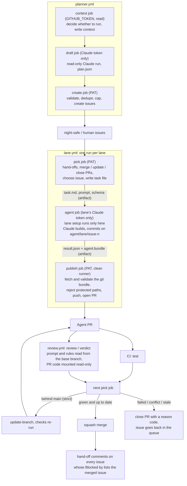

# gh-nightshift

Claude agents build your GitHub issues overnight, in parallel lanes, and merge what passes your tests and an
independent review.

`gh nightshift` is a `gh` CLI extension (Python 3.10+, standard library only, plus the `gh` binary) and three
reusable GitHub Actions workflows:

- `lane.yml` runs one lane: pick an issue, let a Claude agent build it, open a PR.
- `review.yml` is the review gate. A second Claude run, with read-only tools, reviews each agent PR and sets the
  required check `review / verdict`.
- `planner.yml` turns docs, a gap analysis or a request into tickets the lanes can pick up.

A lane is a slice of the repo (for example `api/` or `web/`) with its own Claude token. Each lane works on one
issue at a time. Lanes coordinate only through GitHub issues and machine-readable comments. Nothing runs on
your machine overnight.

It was extracted from the kit used in a hackathon. `docs/EXTRACTION.md` lists every hackathon-specific
assumption and what became of it.

## 10-minute setup

You need admin rights on the repo, `gh` logged in with the `workflow` scope (`gh auth refresh -s workflow`),
Python 3.10 or newer, and a CI workflow whose test job is called `test`. If it has another name, change
`required_checks` in the config.

1. Install the extension.

   ```sh
   gh extension install paawandesai/gh-nightshift
   gh alias set night-shift nightshift   # optional: lets you type `gh night-shift`
   ```

2. Run `init` in your checkout.

   ```sh
   gh nightshift init          # interactive; --yes accepts every suggestion, --dry-run prints the GitHub calls
   ```

   `init` detects your stack, then asks for the lanes, the folders each lane owns, setup and test commands,
   your CI file and the merge mode. It writes:

   - `.night-shift/config.yml`
   - `.github/workflows/night-shift.yml` (one job per lane), `night-shift-review.yml`, `night-shift-planner.yml`
   - `.github/ISSUE_TEMPLATE/night-shift-ticket.md`, `docs/NIGHT_SHIFT_ISSUES.md` (the ticket guide),
     `AGENT_RULES.md` (paste it into your `CLAUDE.md`)

   Then it sets up the repo: labels, squash merge and delete-branch-on-merge, the `AGENTS_ENABLED`
   (`false`) and `FIX_LANE` variables, and a `night-log` issue. Last, it asks for any missing secrets, without
   echoing them. Branch protection waits until step 4, so it does not refuse the push of these files.
   `--tool-ref v0.1.0` pins the workflows to a release (recommended once one exists).

3. Create the secrets (`init` asks for them; `gh nightshift join --lane <name>` lets a teammate add their own).

   | Secret | What it is |
   |---|---|
   | `AGENT_PAT` | A fine-grained PAT for this repo only, owned by the account the night shift acts as. Permissions: Contents, Issues and Pull requests read/write; Actions read. **No Workflows permission.** |
   | `CLAUDE_TOKEN_<OWNER>` | One per lane owner, from `claude setup-token`. The secret name is `lanes[].claude_token_secret`. |
   | `CLAUDE_TOKEN_REVIEW` | For the review gate, ideally from someone who does not own a lane (`review_token_secret`). |

   A lane can name its own PAT with `agent_pat_secret`, so its PRs are credited to the lane owner. While that
   secret is unset, the lane falls back to `AGENT_PAT`.

4. Commit and push the new files to main, then protect main and check the setup.

   ```sh
   gh nightshift setup                     # branch protection: required checks test + review / verdict, strict
   gh nightshift doctor                    # prints a fix for every problem
   gh nightshift doctor --pat-env MY_PAT   # also checks the PAT held in $MY_PAT
   ```

5. Label a few issues `night-safe` plus exactly one `lane:<name>`. Follow `docs/NIGHT_SHIFT_ISSUES.md`, and
   run `gh nightshift lint` to check them against that guide. Then switch it on.

   ```sh
   gh nightshift start
   gh nightshift status   # what each lane would do right now
   ```

Lanes run on every push to main, whenever CI or the review finishes, every 20 minutes, and on manual dispatch.
`gh nightshift pause` stops them.

## How it works



The rules behind the diagram:

- **The agent never shares a runner with the GitHub token.** The pick and publish jobs hold the PAT. The agent
  job gets only that lane's Claude token. Lane setup (commands, a composite action, a Postgres service) runs
  only in the agent job.
- **The publish job trusts nothing the agent produced.** It fetches the bundle into a fresh checkout. It
  rejects the bundle if the diff touches a protected path, and only then pushes and opens the PR. Needs,
  notes and follow-ups are capped.
- **A PR merges only when GitHub's branch protection allows it.** Both required checks (`test` and
  `review / verdict`) must pass, and in strict mode the branch must be up to date with main.
- **One PR per lane at a time.** While a lane's PR is open, that lane only manages the PR.
- **Main must be green.** If the latest CI run on main failed, only the fix lane works, and it works on fixing
  main (`max_attempts` tries per failing commit).
- **Order of work.** Lowest `wave:N` label first, then lowest issue number. An issue is skipped if it is
  assigned to someone, if any `Blocked by` issue is still open, or if it carries `blocked`, `needs-human`,
  `human`, `proposed` or `integrator`.
- **Retries and caps.** A failed attempt retries with the escalate model. After `max_attempts` failed attempts
  (or `infra_cap` runs that never started), the issue gets the `blocked` label. Runs that never started
  (expired token, usage limit, outage), merge conflicts and review-gate errors are refunded, not counted.

## Config reference

Everything lives in `.night-shift/config.yml`. The annotated example is
[`examples/config.yml`](examples/config.yml). The schema, with every key and its limits, is
[`nightshift/schema/config.schema.json`](nightshift/schema/config.schema.json). After changing lanes, run
`gh nightshift init --regenerate` to rewrite the caller workflows.

| Key | Default | What it does |
|---|---|---|
| `lanes[]` | required | `name`, `paths`, `claude_token_secret`, optional `agent_pat_secret`, `model`, `escalate_model`, `description`, `test_command`, `setup.commands`, `setup.action`, `postgres_image` |
| `main_branch` | `main` | Branch the lanes build on and protect |
| `ci_workflow` | `ci.yml` | CI file whose runs on main gate every lane |
| `required_checks` | `[test, "review / verdict"]` | Required status checks; a PR counts as green only when all have reported |
| `fix_lane` | first lane | The only lane that works while main is red |
| `merge.mode` | `strict` | `strict` or `queue` (see below) |
| `protected_paths` | `[]` | Added to the built-in list; never replaces it |
| `models` | `sonnet` / `opus` / `opus` / `opus` | `default`, `escalate`, `review`, `planner` |
| `limits` | 3, 6, 45, 80, 2, 2 | `max_attempts`, `infra_cap`, `stale_minutes`, `max_turns`, `max_needs_per_issue`, `max_notes_per_issue` |
| `planner` | | `docs`, `max_tickets_per_run` (8), `refill_below` (0 = off), `id_prefixes`, `human_paths` (`[contracts/]`), `claude_token_secret`, `schedule`, `enabled` |
| `labels` | | Rename any of the standard labels (`ready` is `night-safe` by default) |
| `review_token_secret` | `CLAUDE_TOKEN_REVIEW` | Claude token secret for the review gate |
| `timezone` | `UTC` | Time zone for night-log lines |
| `tool_ref` | `main` | Ref of gh-nightshift the workflows use. Pin a tag or SHA; `doctor` warns about a moving branch. |
| `bot_login` | you | The PAT's login, for read-only commands run as someone else (`stats`, `audit`, `digest`) |
| `trusted_logins` | `[]` | Other PAT logins to trust, when lanes use their owners' own PATs (`join --lane X` stores one) |
| `lanes[].budget_usd_per_night` | off | Optional cap: the lane stops picking for the night (noon to noon in `timezone`) once its night-log cost lines reach it |
| `auth` | `mode: pat` | `mode: app`, `app_id`, `private_key_secret` (`NIGHT_SHIFT_APP_KEY`): a GitHub App instead of `AGENT_PAT` |
| `risk` | `default: auto` | `default` (`auto` or `approve`), `approve_labels`, `approve_paths`, `auto_labels` (see Risk tiers) |
| `digest` | | `enabled` (true), `schedule` (`0 7 * * *`, UTC), `webhook_secret` (optional secret holding a Slack or Discord webhook URL) |

Repo variables override some settings at run time without a commit: `AGENTS_ENABLED`, `FIX_LANE`,
`ESCALATE_MODEL`, `REVIEW_MODEL` (fallback), `PLANNER_MODEL`, `CLAUDE_CODE_VERSION` and
`CLAUDE_PERMISSION_FLAGS`. A project can replace a prompt by committing `.night-shift/prompts/worker.md`,
`review.md` or `planner.md` on the default branch.

## The comment protocol

Every fact that lanes share is a hidden marker inside an ordinary comment:

```html
<!-- ns:{"from":12,"lane":"api","pr":40,"to":15,"type":"handoff"} -->
```

**Trust rule.** A marker counts only if the comment was posted by the PAT's own login, the account the lanes
act as. Anyone else can paste the same text, and it is ignored, even when the author is a repo admin. So an
outsider cannot forge attempt counts, unblock an issue or steer work.

| Type | Where | Meaning |
|---|---|---|
| `attempt`, `infra`, `blocked`, `waiting` | issue | Attempt bookkeeping. `infra` (never started) and `waiting` do not count as failed attempts. |
| `fix-attempt`, `fix-infra` | night-log issue | The same bookkeeping for fix-main, per failing commit |
| `need` | waiting issue | `{"from": waiting issue, "to": provider issue, "lane": provider's lane}` |
| `handoff` | dependent issue | `{"from": merged issue, "to": dependent issue, "pr": merged PR}` |
| `note` | receiving issue | `{"from": sender issue, "to": receiver issue}` |
| `note-sent` | sending issue | One per note sent, so the cap can be counted |
| `pr` | PR | `{"reason": ..., "pr": n, "issue": n}` |
| `handoff-data` | PR body | The agent's hand-off, read when the PR merges |
| `handoff-done` | merged PR | Hand-offs went out (makes the step idempotent) |
| `plan` | night-log issue | A planner run: lane, `complete`, `docs_sha` |

**Hand-off.** When a PR merges, the picker posts a hand-off comment on every open issue whose `Blocked by`
line lists the merged issue (for PRs merged in the last 72 hours). The comment gives the interface as built
(functions, endpoints), files, env vars, decisions and assumptions from the agent's `handoff` output. It also
quotes the ticket's `## Interface` section and flags any difference the agent reported. The next agent sees
these comments in its task file, in a section marked trusted.

**Waiting on another lane (needs).** An agent that hits something another lane owns and that does not exist
yet reports `waiting`, with up to 2 `needs`. For each need, the publish job does three things:

1. It files a ticket in that lane, or reuses an existing one with the same title. The ticket is
   `night-safe` if it passes the ticket validator, `proposed` if it does not, and `human` if it touches
   protected or contract paths.
2. It appends `Blocked by: #new` to the waiting issue and labels the issue `waiting`.
3. It records the attempt as not counted.

Needs are capped at `max_needs_per_issue` (2) per issue across all runs. A need that would create a
dependency cycle is refused, and the issue gets `needs-human`. If no need could be filed, the run counts
as a failed attempt.

**Notes.** An agent can send up to `max_notes_per_issue` (2) informational notes per issue to other open
issues, for example "I added helper X you can reuse". Notes are quoted and never change state.

**PR reason codes.** Every agent PR that closes without merging gets a `pr` marker with one of
`verdict_failed`, `checks_failed`, `conflict`, `stale` (no checks after `stale_minutes`) or `superseded`
(its issue closed, or a newer attempt replaced it). A closed PR with no marker counts as `manual`.
Merged PRs get `verdict_passed`. `gh nightshift stats` reports these codes.

## The planner

The planner drafts tickets in a read-only Claude run. A separate job holding the PAT validates and creates
them.

| Mode | How it starts | What it plans |
|---|---|---|
| `prd` | `gh nightshift plan --from docs/PRD.md`, or the planner workflow's dispatch | Every requirement in the docs |
| `gap` | `gh nightshift plan --gap [--lane X]`, or dispatch | What the docs ask for and the code lacks |
| `review` | A comment starting with `/night-shift plan <request>` on an issue, from a user with write access | Only what the request needs; the request is fenced as data |
| refill | Timer (`planner.schedule`) when `planner.refill_below > 0` | Gap mode for the lane with the fewest ready issues, when it has fewer than `refill_below` |

The validator applies the ticket guide (`docs/NIGHT_SHIFT_ISSUES.md`). A ticket must have:

- a title `[ID] outcome` (the ID is assigned if missing; a malformed or reused ID is rejected),
- `Goal`, `Do`, `Acceptance` and `Files` sections,
- exactly one configured lane and a wave from 0 to 99,
- a `## Interface` section if it has a `Blocked by` line or another ticket depends on it,
- `Blocked by` targets that exist (another draft or an existing issue), with no cycles,
- a title that does not duplicate an open issue.

Tickets that touch protected paths or `planner.human_paths` (default `contracts/`) are created as `human`
tickets, which agents skip. Invalid tickets are not created, nor are tickets that depend on a rejected
ticket. A run creates at most `planner.max_tickets_per_run` tickets (8), in dependency order.

**Coverage stopping rule.** The plan lists every requirement as `done`, `ticketed` or `deferred` (with a
reason). When nothing is left uncovered, the run is complete and is logged on the night-log issue with the
docs' commit SHA. Refill does not run again until the docs change.

Follow-up work an agent notices while building is filed as `proposed` (at most 3 per run, deduplicated).
Agents skip it until a person relabels it `night-safe`.

## Commands

Every command that writes to GitHub accepts `--dry-run`, which prints the exact `gh api` and `gh secret set`
calls instead of making them. All commands accept `--repo OWNER/NAME` and `--root PATH`.

| Command | What it does |
|---|---|
| `init` | Write config and workflows, set up labels, settings, variables, night log, roadmap, secrets (branch protection: run `setup` after pushing). `--yes`, `--lanes`, `--tool-ref`, `--force`, `--regenerate` (rewrite workflows only), `--files-only`, `--skip-secrets`, `--dry-run`. Fully non-interactive with `--yes --lanes api,web --preset python --paths api=api/ --budget 5 --secrets-from-env` |
| `setup` | Re-apply labels, settings, variables, branch protection, the night log and the roadmap |
| `join --lane X` | A teammate stores their Claude token and their own PAT for a lane (`--no-pat` to skip); prints the `trusted_logins` line to add |
| `doctor` | Read-only checks with a fix for each problem (`--pat-env VAR` checks a PAT; repeat it for each) |
| `status` | What each lane would do now, the queue, open agent PRs, blocked and waiting issues, the night log |
| `stats` | Merge rate with a 95% interval, reason codes, escalation share, cost per merged PR (`--audit CSV` adds the review gate's catch rate). Counts PRs and markers from `bot_login` in the config (default: you), so set it when the PAT is another account. |
| `plan` | Draft and create tickets: `--from PATH`, `--gap`, `--lane X`, `--plan-file` (publish an existing draft) |
| `start` / `pause` | Set `AGENTS_ENABLED` to `true` / `false` (the kill switch); `pause` also cancels lane runs in flight (`--no-cancel` to let them finish) |
| `freeze` / `resume` | Pause (and cancel) and move every ready issue to `human` + `frozen`; `resume` undoes it and starts |
| `take N` / `retry N` | Take a ticket yourself, or put it back in the queue with fresh attempts (same as the comment commands) |
| `app manifest` / `app check` | Print the GitHub App to create; mint a token locally and show its login and permissions |
| `roadmap` | Create or refresh the roadmap issue: tickets by wave with status, a Blocked-by mermaid graph, counts per lane. The planner and every merge refresh it too. `plan --show` prints it without writing. |
| `digest` | Summarise the last `--hours 24`: merged, closed with reasons, stuck, cost per lane. `--post` puts it on the night log; `--webhook-env VAR` also sends it to the Slack or Discord webhook URL in `$VAR`. The generated `night-shift-digest.yml` runs it every morning. |
| `lint` | Check ready issues against the ticket guide |
| `audit` | Sample merged agent PRs (`--sample 25 --seed 1`), collect evidence, optionally rerun tests (`--test-cmd`), and report rates (`--report CSV`; `--label-llm CSV` pre-fills LLM labels, which are not ground truth) |

## Merge modes

- **`strict`** (default): branch protection requires PRs to be up to date with main. When a lane's PR is
  behind main, the picker calls `update-branch`, and CI and the review run again on the merged result. A
  conflict while updating closes the PR as `conflict`, and the attempt is refunded. Main is never ahead of
  what was tested, but each update re-runs CI and the review.
- **`queue`**: `setup` creates a GitHub merge queue ruleset, and your CI must also run on `merge_group`
  (`doctor` checks this). The queue tests the merged result, so the branch need not be up to date.
  Limitation in v0.1: the picker does not add PRs to the queue or enable auto-merge, so a person (or other
  automation) must queue green agent PRs. Use `strict` for unattended nights.

## Risk tiers

Green agent PRs merge on their own by default. In `strict` mode you can ask for one human approval first:

```yaml
risk:
  default: auto            # or approve: every PR needs one, except tickets with an auto_labels label
  approve_labels: [risk:high]   # on the issue or the PR
  approve_paths: [migrations/, infra/]
  auto_labels: [risk:low]
```

A PR that needs approval gets the `needs-approval` label and one comment. It merges on the next lane run after
someone with write access who did not open it approves its latest commit. Waiting for approval does not hold
up the lane: it moves on to the next ticket and never re-picks that one.

## Comment commands

People with write access can comment on a ticket (or on its agent PR):

| Command | What happens |
|---|---|
| `/night-shift take` | You take the ticket: assigned to you, labelled `human`, agents skip it. An agent PR already open for it still merges when green; close it if you don't want that. |
| `/night-shift retry` | Back in the queue with fresh attempts: `blocked`, `needs-human`, `human` and `frozen` are removed, `night-safe` added, a closed issue is reopened and a `take` is undone. Hints in your comment reach the next agent through the discussion section. |

Both accept `#n` to name another ticket. `gh nightshift take N` and `gh nightshift retry N` do the same from
the terminal. They run in the generated `night-shift-commands.yml` with the PAT (or the App).

## GitHub App (instead of a PAT)

A GitHub App gives the night shift its own `<app>[bot]` identity and tokens that expire after an hour.

1. `gh nightshift app manifest` prints the App to create: Contents, Issues and Pull requests read/write,
   Actions read, no Workflows, no webhook. Create it, install it on this repository only, and generate a
   private key.
2. `gh nightshift init --app-id <id> --app-key-file key.pem` (or add `auth: {mode: app, app_id: <id>}` to the
   config, run `init --regenerate` and `gh secret set NIGHT_SHIFT_APP_KEY < key.pem`).
3. `gh nightshift app check --key-file key.pem` mints a token locally and prints its login and permissions
   (never the token). Put the login in `bot_login`.

The callers then pass `app_private_key` instead of `agent_pat`, so each lane still receives exactly two
secrets. Each PAT job (pick, publish, planner create, commands, digest) mints an installation token for this
repository only, down-scoped to exactly those permissions; the agent job never sees the key or the token.
Per-lane PATs (`agent_pat_secret`) are not used in App mode.

## Costs

Each lane uses its own Claude token, so usage is spread across the lane owners' plans.

- **Models.** The first attempt uses the lane's model (`lanes[].model`, else `models.default`, `sonnet`).
  Retries and fix-main use the escalate model (`lanes[].escalate_model`, else `models.escalate`, `opus`). A
  `model:<alias>` label on an issue overrides both. The review uses `models.review` and the planner uses
  `models.planner` (`opus` by default).
- **Turn limits.** An agent run stops after `limits.max_turns` (80). The review is capped at 30 turns and the
  planner at 60.
- **What drives cost.** Turns per run (large tickets, slow test suites, long setup), retries on the stronger
  model, and one review per push to a PR. In strict mode, every `update-branch` is a push, so it costs one
  more review. Closed PRs are spent money. Small, well-specified tickets are the cheapest lever.
- **Measuring it.** Each run logs Claude Code's reported cost on the night-log issue. With subscription
  tokens, this is an API-equivalent figure, not a bill. `gh nightshift stats` divides the total by merged
  PRs. The first real run came to about $0.50 API-equivalent per merged PR.

## Results from the first real run

These numbers come from the hackathon kit that gh-nightshift was extracted from, run on one repo.

- 139 agent PRs: 110 merged (79%, 95% CI 72–85%).
- 1 issue was ever marked `blocked`. 0 merged PRs were reverted.
- About $0.50 API-equivalent per merged PR.

An audit of n=25 merged PRs (random sample, `gh nightshift audit`) found:

- 72% ok (95% CI 52–86%).
- Tests meaningful in 92% (95% CI 75–98%).

Caveats:

- The audit labels came from an LLM and are still waiting for a human check.
- With n=25, the detection floor is about 36 points: differences smaller than that cannot be told apart
  from noise.
- "Fixed later" mixes real defects with planned follow-up work, so it is not a pure defect rate.

Intervals are Wilson score intervals (`nightshift/stats_math.py`).

### Changed because of what the audit found

- **A) Strict, up-to-date branch protection with automatic branch updates.** One PR had merged with a test
  failing at its own merge commit, because protection did not require PRs to be up to date. Now
  `merge.mode` is `strict` (up to date required; the picker calls `update-branch` and waits for checks to
  re-run) or `queue` (merge queue). Conflicts close the PR as `conflict`.
- **B) The reviewer checks main drift since the PR's base.** The review gets
  `git diff <merge-base>..origin/main --stat`, plus the main-side diffs of files the PR also touches. It
  answers a sixth question: did main change in anything this PR touches or depends on, and if so, is the PR
  still correct against current main?
- **C) A required `## Interface` section for dependent tickets.** Any ticket with a `Blocked by` line, or
  one that another ticket depends on, must state exactly what crosses the boundary. The planner rejects
  tickets without one, and `lint` flags them. When the PR merges, the hand-off restates the interface as
  built and flags differences from the ticket.

## Security

The agent never holds the GitHub PAT. Each lane receives exactly two secrets, named explicitly. Changes to
protected paths are rejected before push. Only comments from the PAT's own login are trusted. The full threat
model and its known gaps are in [SECURITY.md](SECURITY.md).

## Development

```sh
python3 -m unittest discover -s tests
ruff check nightshift tests
```

See `CLAUDE.md` for the rules contributors and agents follow.
